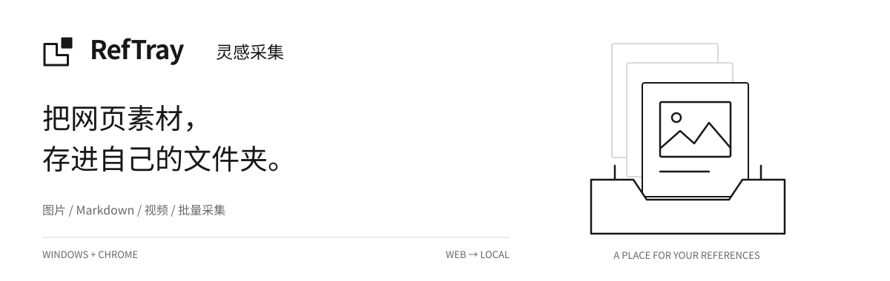

<p align="center">
  
</p>

<p align="center">
  <a href="https://github.com/iiiiivy123/inspiration-collector/releases/tag/v0.5.28"></a>
  &nbsp;
  <a href="docs/README.md"></a>
</p>

<p align="center">
  <a href="#能收集什么">功能介绍</a> · <a href="#开始使用">快速开始</a> · <a href="docs/use-cases.md">使用场景</a> · <a href="https://github.com/iiiiivy123/inspiration-collector/issues">问题反馈</a> · <a href="README_EN.md">English</a>
</p>

**RefTray · 灵感采集** 是面向设计师、插画师与内容创作者的 **Windows + Chrome 本地素材采集工具**。从支持的网页保存图片、Markdown 图文、纯文字与视频，部分作者页和画板支持批量采集，视频还可按需提取参考画面。

**你选择文件夹，素材就保存在那里。**

## 能收集什么

<table>
<tr>
<td width="50%" valign="top"><h3>图片与视觉参考</h3><p>从适配的作品页保存图片，收集构图、服装、场景与设计参考。</p></td>
<td width="50%" valign="top"><h3>图文与纯文字</h3><p>整理为 Markdown；按需附带正文图片、已加载评论与图片文字识别结果。</p></td>
</tr>
<tr>
<td width="50%" valign="top"><h3>视频与参考画面</h3><p>保存支持的视频，按需抽帧；也支持对本地视频提取参考画面。</p></td>
<td width="50%" valign="top"><h3>批量与任务恢复</h3><p>处理支持的作者页或画板，查看采集记录、去重结果，并继续或重试部分未完成任务。</p></td>
</tr>
</table>

## 从网页，到自己的文件夹


图片、图文、视频和批量内容按类型与来源整理。更改素材库位置不会自动搬迁旧文件；历史记录可帮助打开此前的保存目录。

## 开始使用

**需要 Windows 10/11 64 位 + Chrome。** 安装包内置 Python 与媒体组件，不用自己配置开发环境。

1. **下载安装。** 前往 [Releases](https://github.com/iiiiivy123/inspiration-collector/releases/tag/v0.5.28)，在 **Assets** 下载 Windows 安装包，不要下载源码 ZIP。
2. **启动本地程序。** 打开「灵感采集」，程序会在 Windows 右下角系统托盘运行。
3. **加载 Chrome 扩展。** 打开 `chrome://extensions` → 开启「开发者模式」→「加载已解压的扩展程序」。从托盘菜单复制 `extension` 文件夹的实际地址，选择该文件夹。
4. **保存第一份素材。** 固定工具栏扩展，选择本地素材库，打开支持的作品页并选择采集内容。

[首次安装 →](docs/install.md) · [旧版更新 →](docs/update.md) · [完整教程与故障排查 →](docs/usage.md)

当前版本是 **0.5.28 朋友试用版**。更新内容、测试结果和已知问题见 [版本说明](docs/release-0.5.28.md)。

> **更新旧版：** 先在系统托盘右键 → **退出灵感采集**，再安装新版，最后到 Chrome 扩展管理页点**重新加载**。仅关闭浏览器或弹窗不会退出后台。

目前需要手动加载扩展，**尚未上架 Chrome 扩展商店，没有手机端和自动更新**。安装包暂未签名；请核实下载来源，不要关闭安全防护。

## 能在哪些网站使用？

**小红书 · Pinterest · Instagram · X · 花瓣 · B站**，以及部分其他网页图片。

各平台可用的采集方式见下表。

<details>
<summary><strong>展开查看各平台适配范围</strong></summary>

| 平台 | 目前适配的范围 |
| --- | --- |
| 小红书 | 单篇笔记的图片、图文、纯文字及部分视频模式；部分作者页面批量 |
| Pinterest | 当前 Pin、具体画板的相关图片采集；画板批量不支持图文模式 |
| Instagram | 帖子、Reels 与部分作者帖子列表 |
| X（原 Twitter） | 单帖和部分作者帖子列表；批量不包含转帖 |
| 花瓣 | 当前页面和部分图片批量模式 |
| B站 | 受支持的视频稿件及 UP 主投稿列表，支持符合条件的视频保存、抽帧 |
| 其他网页 | 主要是当前页面的图片，不提供通用批量 |

采集范围受页面类型、登录状态、已加载内容与媒体格式影响。程序只处理可访问的内容，不绕过访问限制。详见 [平台使用场景与常见问题](docs/use-cases.md)。

</details>

## 常见问题

**能把小红书笔记保存成 Markdown 吗？**  
可以，在支持的笔记页选择图文或纯文字模式。评论只涵盖当前已加载、能够识别的部分。

**能批量保存 Pinterest 画板吗？**  
可以。打开具体画板，选择批量图片模式；处理范围是程序能识别、能访问的 Pin。搜索结果和隐藏内容不在此范围内。

**素材会上传到项目服务器吗？**  
素材由本机服务直接写入你选择的文件夹，不上传到项目云端。采集时仍会访问来源网站和媒体 CDN。

[更多使用问题 →](docs/use-cases.md)

## 项目文档

| 想做什么 | 从这里开始 |
| --- | --- |
| 安装、更新、解决使用问题 | [首次安装](docs/install.md) · [旧版更新](docs/update.md) · [完整教程](docs/usage.md) |
| 了解平台适配和实际场景 | [中文场景与 FAQ](docs/use-cases.md) · [English use cases](docs/use-cases-en.md) |
| 查找全部文档 | [文档导航](docs/README.md) |
| 介绍项目、查看图标方案 | [品牌与图标](docs/brand-guide.md) |

<details>
<summary><strong>名称、版本与文件位置说明</strong></summary>

**RefTray · 灵感采集** 是对外展示名称；较早文档中的 **InspiShelf** 也指这个项目。当前版本 **0.5.28**，为朋友试用版。安装器、快捷方式、托盘和扩展继续使用「灵感采集 / Inspiration Collector」。下载和已知问题见 [版本说明](docs/release-0.5.28.md)。

首页采用已选定的简洁文件图标：空心文件轮廓与右上实心方块，不加内部横线。横幅固定使用白底，不随深色模式切换；0.5.28 构建已将同一 A 款标识应用到扩展与 Windows 程序图标。

```text
你选择的素材库/
├── 图片/平台/作品/
├── 图文/平台/作品/
├── 视频/平台/作品/
└── 批量/平台/作者或画板/
```

这是结构示例，实际目录随采集模式变化。

</details>

---

**独立第三方项目，非相关平台官方产品。** 仅在拥有相应权利、获得许可或其他合法依据时保存内容；公开可见不等于允许再分发或商用。[版权与隐私](docs/rights-and-privacy.md)

源代码可公开查看，但**项目尚未选定开源许可证**；第三方组件遵守各自许可。[第三方声明](docs/third-party-notices.md) · [媒体组件说明](docs/third-party-media.md)

维护：[iiiiivy123](https://github.com/iiiiivy123) · [提交反馈](https://github.com/iiiiivy123/inspiration-collector/issues)。反馈请附版本、复现步骤与脱敏截图，不要上传 Cookie、凭据、私人资料或受版权保护的完整媒体。开发过程中使用 OpenAI Codex 辅助。
