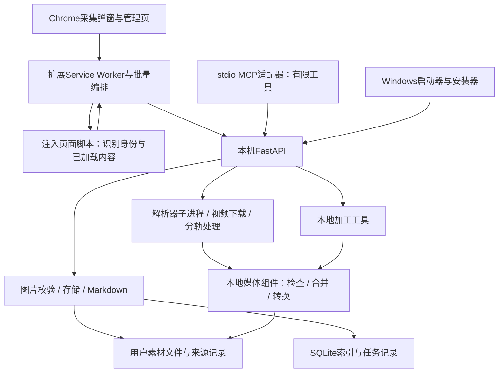

# RefTray 全仓代码审查交接与任务书

更新：2026-11-06（Asia/Shanghai）。这是交给独立审查者的项目背景、检查范围和已知问题清单，**不是已经完成的审查结论**。请审查整个仓库，不能只复核0.5.37的改动，也不能把本文件列举的问题当作全部问题。

## 1. 先确认拿到哪份代码

仓库：https://github.com/iiiiivy123/RefTray

| 对象 | 本次核对的状态 |
| --- | --- |
| `main` | 当前统一主线，已合入0.5.37产品代码、构建预检及全仓审查文档 |
| 历史分支 | 已在原工作机归档；GitHub的旧开发分支由本次仓库整理清理 |
| `58a62d4b9e113a5cc939bd8aa74d43ce6ac890f6` | 0.5.37产品代码、规格及交付说明所在提交 |
| `db07532` | 后补构建依赖前置检查、反例检查及SPEC B02；产品采集代码和已交付安装包没有随之重做 |
| 本机安装状态 | 最后核验仍为0.5.36；此后用户是否安装0.5.37须重新确认，不能从源码版本推断 |

请直接检出 `main`，记录实际HEAD，审查**整棵代码树及必要历史**。0.5.37最初通过独立分支交付，现按用户要求合回main。历史分支和合并前main已保存在原工作机的本地分支与Git bundle中。

0.5.37安装包SHA256为 `5e26565787e2a8dac11cd6f91ab58afc7829e68ababdb0e0a08d4219b30ba9f6`，产品代码对应58a62d4。后续提交更新了构建检查与说明文档，网页采集代码保持原样。本机安装和Chrome加载版本按现场连接状态核对。

## 2. 这个产品是什么

**RefTray／灵感采集是Windows + Chrome的本地网页素材采集工具**，面向需要整理视觉参考、文章和视频素材的用户。用户选择本机素材库，在网页上通过Chrome扩展采集；本地Python后台负责校验、下载、处理、落盘和索引，Windows程序负责安装、启动、托盘和更新退出。

主要工作包括：

- 保存当前作品的图片/GIF；保存正文及可选图片、评论、OCR结果为Markdown，也有纯文字模式。
- 保存适配平台的视频，按需抽帧、提取音频；新增本地视频转GIF和音频提取工具。
- 对部分作者列表、画板进行批量处理，按数量/媒体过滤，去重、补齐缺失，并记录停止、恢复和失败项。
- 设置默认参数、素材库和目录方式；查看采集记录、任务记录、诊断；升级时同步实际Chrome扩展路径。
- 提供本地stdio MCP适配器，让AI调用已有后台的有限能力。

项目实现中有小红书、Pinterest、Instagram、X、花瓣、B站、YouTube及通用网页的相关入口，但**有适配文件或菜单不等于所有模式、页面类型、登录条件和媒体形式都已经可用**。需要逐个平台、模式和入口核对，不可直接照抄README的支持列表作为验收结论。

素材原则上留在用户的本机目录；获取媒体仍要访问来源网站。浏览器加载、系统代理、解析器、后台下载各自可能使用不同访问环境，不能把“Chrome已登录”自动等同于“所有后台请求已有登录会话”。

## 3. 当前实现的架构与完整链路

这张图描述现有职责分布，不证明代码已经严格遵守这些边界。实际代码有跨文件共享变量、兼容入口、回退和历史状态，审查者必须检查真实调用关系。

| 区域 | 主要代码及应追踪的职责 |
| --- | --- |
| 扩展入口与展示 | `manifest.json`、`popup*.js/html/css`、`manage*.js/html/css`、`settings.js`、`i18n.js`、`rounded-select.js`；页面切换、参数、语言、分页、结果展示 |
| 扩展任务编排 | `background.js`、`batch.js`、`task-services.js`；当前页、列表/画板、解析、预检、下载提交、控制及反馈 |
| 参数和状态 | `capture-options.js`、`task-store.js`、`task-progress.js`、`hub-api.js`；默认值/草稿/续采的优先级、冻结、版本、同步和派生进度 |
| 平台与正文提取 | `platforms.js`、`page-identify.js`、`page-media.js`、`pinterest-identity.js`、`x-comments.js`及各平台脚本；主作品身份、正文/评论/引用/推荐的边界、静态图/封面/GIF/视频的区分 |
| 本机服务 | `server/app.py`、`desktop.py`、`config.py`、`models.py`、`components.py`；协议、工厂/兼容入口、鉴权、任务生命周期和组件能力 |
| 图片、正文和归档 | `storage.py`、`catalog.py`、`destinations.py`、`image_download.py`、`image_validation.py`、OCR、旧目录导入等；下载安全、解码、幂等、去重、来源、命名和迁移 |
| 视频与音频 | `media_resolver.py`、`resolve_public_media.py`、`download_public_media.py`、`segmented_media.py`、`video.py`、B站/字幕/缓存等模块；解析器子进程、主帖身份、视频选取、分轨、完整性、停止和临时文件 |
| 后期加工 | `gif_media.py`、`media_output.py`、`local_tools.py`和本地页面；网页采集与本地加工的职责隔离、组件限制、原件保留 |
| AI接口 | `mcp_stdio.py`；MCP协议、输入/输出、错误语义、后台连接和会话能力，不能假设它等于远程控制已登录Chrome |
| 安装、构建和维护 | `installer/Launcher.cs`、`setup.iss`、`extension_install.py`、`maintenance.py`、`tools/`、锁定依赖及许可证资料；版本/路径一致、进程归属、升级/卸载、离线构建与供应链 |
| 规格、测试及发布资料 | `AGENTS.md`、`docs/SPEC.md`、`docs/CURRENT.md`、README、版本说明、`tests/`；规范是否有实际检查、证据是否足以支撑支持范围 |

至少完整追踪两条端到端链路：

1. **网页采集**：用户设置 → 参数快照 → 目标作品/回复身份 → 提取结果 → 媒体类型与过滤 → 解析/下载 → 解码或处理 → 文件写入 → 来源/索引 → 任务同步 → UI展示 → 重启后再查记录/文件。
2. **安装更新**：构建宿主与依赖 → payload → 安装器 → 旧后台/独立MCP/子进程停止 → 文件替换 → 实际扩展路径同步 → 后台启动 → Chrome重新加载 → 运行版本和已保存文件核验。

## 4. 审查规范及其来源

- 项目入口是 `AGENTS.md`，现状是 `docs/CURRENT.md`，项目功能约定是 `docs/SPEC.md`。其中B01职责边界、B02构建前检查、G01网页GIF、C01评论、T01任务状态、U01工具、V01交付证据都需要与实现逐条比对。
- 通用工程/QA规范在本机Ivy启用目录。其他机器无法读取时，明确写“未加载该环境规范”；不猜测、不伪造，也不把项目文档当作已经执行检查的证据。仍可继续基于可读代码、项目规格和用户要求开展审查，指出需要补充的规范材料。
- 本次审查应检查：职责是否集中、状态/配置是否有权威来源、错误和合法空结果是否区分、参数是否集中校验、旧数据是否兼容、处理是否可停止/恢复、依赖是否锁定且构建可重复、实现是否有适当回归测试。
- 不用文件行数、抽象层数或设计模式数量判定架构好坏。关注“为什么改A会破坏B”、重复规则和真实依赖；需要拆分时说明最小必要边界及迁移风险。
- 先审查并提供有证据的结论。用户希望避免继续返工，不应直接在审查阶段做全仓重构、重装、移库、删数据或修改已可用链路。后续修复按用户确认的范围执行。

## 5. 优先审查的问题：不能只做格式检查

### 5.1 架构、状态所有权和模块间约定

- `background.js`、`batch.js`、`task-services.js`等共享全局状态和上下文，任务并发/切换、页面跳转、Service Worker退出/重启时是否会串任务、串选项、串保存目录？
- 预识别和正式采集有多套判断，图片/GIF/视频/纯文字类别是否一致？为什么出现过页面可见媒体而返回0？未知/未加载/排除/失败是否被压成同一个空数组？
- 默认值、模式记忆、弹窗草稿、当前任务和续采参数是否各自有明确寿命？修改默认值会不会改动正在执行的任务？新参数加入后旧检查点如何处理？
- Chrome本地日志、outbox、检查点、后台SQLite及实际文件之间谁拥有哪一类事实？revision、幂等、resolvedBy、localOnly等字段是否有清楚语义？离线、冲突、同步失败会不会丢结果或隐藏任务？
- UI布局脚本搬动控件时是否改变业务行为，事件与结果区是否仍配套？新增工具是否真正复用已有能力，还是复制另一套规则？

### 5.2 采集正确性、兼容性和失败保留

- 主帖、评论、引用、推荐、头像和视频封面必须有不同归属。不能通过扩大到整页抓图来掩盖漏提取。
- 评论按回复而非图片计数；纯图片回复、相同文字的不同回复、嵌套回复、页面排序和不足目标数量如何处理？图片保存是否能回到对应回复和来源？
- 没有可保存内容、组件缺失、需要会话、网络失败、部分成功、主动跳过和复用已有素材是否显示为正确状态？用户点击开始后解析就失败的任务能否保留和再次找到？
- 文件、来源记录、Markdown引用和SQLite之间是否会出现只成功一部分却标为全部成功？重复策略是否会复用用户认为已经“重新下载”的旧路径？
- 批量的目标上限、已检查条目、当前条目字节百分比、实际保存数和失败数不能混用。未知总量不能编造0%或假完成。

### 5.3 会话、网络、安全和可维护性

- 浏览器登录态、页面已加载数据、解析器子进程和后台HTTP请求的会话边界是否明确？接口需要会话时怎样反馈？不要把助手浏览器连接超时当成用户未登录。
- 图片、视频、分段流、解析器和MCP是否一致使用预期代理？系统代理、代理DNS、无代理和代理不可用时的行为是否可解释？国外无需代理的用户不应被本机路径或强制代理配置限制。
- 本地API绑定、鉴权、Origin/CORS、令牌暴露面、MCP输入验证、下载域名/重定向/公网IP限制、TLS及子进程参数是否足够？本地文件上传、媒体处理和打开目录是否可能越界或消耗失控？
- 不得把Cookie、授权令牌、个人浏览历史、实际用户素材或本机日志上传到审查报告/仓库。需要现场证据时使用最少、脱敏的数据。
- 授权停止、异常退出、升级和超时时，下载/转码/上传线程与子进程是否都能收尾？临时文件与正式文件怎样区分？

### 5.4 构建、安装、发布和规范执行

- 依赖预检是否确实发生在创建payload、复制运行时、安装依赖和编译之前？预检与正式安装是否使用相同参数和隔离的pip环境？新入口是否只在文档中存在？
- 锁文件、离线wheel、哈希、目标架构、构建Python和运行Python是否一致且可追溯？审查输入准备脚本、用户ZIP和安装器等旁路，不能只看一个入口。
- 安装器是否只结束可确认归属的进程？启动器之外的MCP stdio进程曾占用DLL；是否仍有遗漏或误杀风险？未知占用是否在替换前失败？
- 源码、payload、安装目录、历史Chrome加载目录、已运行后台及Chrome实际加载版本是否能核对？仅同步磁盘文件不能算浏览器已更新。
- 第三方代码、可选解析器、FFmpeg二进制/对应源码/许可证及产品自身许可是否交代清楚？不要因为源码公开就假设项目已采用开源许可证。
- Git分支、公开README、版本说明和实际安装包的版本是否互相误导？规范写入、脚本执行、本机验证、CI和合并保护是不同事实，应分别检查。

## 6. 反复发生过的返工与当前结论

| 问题 | 已知情况和审查重点 |
| --- | --- |
| Pinterest旧版能下，新版找不到图 | 调整列表/瀑布流排除范围后，真实Pin正文容器被误排除；后来针对真实页面结构修正，两条原失败Pin得到用户成功回执。检查排除规则、身份与回退边界，不要再盲目扩大或缩小范围。 |
| X网页GIF入口失效/统计为0 | 曾发生后台能转换、图片/GIF入口失败；较晚用户确认安装版恢复。早期将后端和VM通过当成完整入口修复的证据不足。当前用户明确要求冻结已可用链路。 |
| X视频只保存封面或混入其他媒体 | 原反复失败视频未完成全链路验收，不能认定通用已修复。要检查主帖身份、引用/评论隔离、会话条件、解析器及下载衔接；不能未经证据就归咎于网站或认定存在内容过滤。使用可合法处理的代表样本独立验证。 |
| 评论没有文字/图片 | 先前只看到通用配置为空就说X完全没实现，判断不完整；实际有独立x-comments.js，但要求确认父帖且只保存有文字回复。0.5.37补数量、纯图片和关联保存，完整安装入口仍缺验收。 |
| 安装后扩展还是旧版本 | 程序目录更新与Chrome实际引用目录不同；已补历史目录登记/同步。需核对路径迁移、失败反馈和不同用户机器，不能每次靠人工复制。 |
| 安装DLL拒绝访问 | 后台已退出但AI宿主持有的独立MCP Python进程仍加载DLL。已补精确归属检查；正式升级仍曾需要用户先退出托盘。不要据局部隔离验证就宣布所有升级场景完成。 |
| 进度一直0%/显示“媒体分段” | 普通直链也进入统一下载路径，阶段文案和总量传播错误；已补真实阶段/未知百分比，但仍需核对不同路径与批量口径。 |
| 诊断按钮似乎点不开 | 布局把按钮移走，结果留在折叠区域；0.5.37合并入口。检查其他搬动控件是否有同类问题。 |
| 未完成为空、失败或旧任务详情找不到 | 结束状态与保存成功混用、先分页后筛选、已同步记录残留localOnly标记等问题；0.5.37有针对性修正，需审查旧数据、离线/回同步和全部分页路径。 |
| 到打包才发现依赖问题、反复请求继续 | 构建环境和pip默认配置未前置验证；db07532增加预检。检查是否覆盖所有构建准备入口，并区分旧包与后补工具的证据。 |

这些是已知历史和局部修正，不是审查者可以直接接受的“已全部解决”清单。应检查原因是否准确、同类分支是否遗漏、修复是否引入新问题。

## 7. 尚未实现、尚未验收和当前限制

| 项目 | 当前分类与边界 |
| --- | --- |
| 评论GIF | **明确未接入**。目前评论保存文字和静态图，不应因网页GIF能保存就标为支持评论GIF。 |
| 自动加载到前N条评论 | **未实现**。当前只处理已加载、能确认父帖的直接回复；目标10而只读到6必须说明，不能冒充10。 |
| 新评论、本地加工完整Chrome入口 | **有实现、欠完整验收**。已有分层测试和真实文件结果，不能替代0.5.37实际安装扩展中的全链路。 |
| 原反复失败X视频 | **结果仍未确认**。不能写全部修复，也不能以某个安全视频成功推导所有视频可用。 |
| MCP复用已登录Chrome | **能力缺口**。现有MCP只调用本机后台，图片工具只确认Pinterest/X分享图身份，不保证多图/登录受限媒体；视频工具仍依赖已有解析器。不是“贴链接即可获得Chrome全部会话”的完整接口。 |
| 各平台/模式完整支持矩阵 | **需要补证据**。不同平台的评论、批量、轮播、视频和会话条件不能相互推导。 |
| 0.5.37真实覆盖升级 | **待验收**。构建和启动检查已完成；真实升级、卸载及Chrome路径切换列入后续验证。 |
| 所有解析前失败都留记录 | **原受理后记账路径保留，缺全入口回归**。需检查没有进入下载的失败、无后台时本机记录及后续同步。 |
| 整体架构解耦 | **尚未完成系统性审查/整改**。本轮是局部修正；不能因有多个文件就称已经解耦。 |
| 自动更新、商店安装、手机端 | README明确尚无相应产品化能力，不是此次已经承诺交付的功能；审查时标清范围，避免擅自扩项。 |

## 8. 已有验证能证明什么

- 0.5.37：13项JS行为检查，任务/存储/Pinterest布局15项Python检查，本地加工2项Python检查，以及8项管理页浏览器夹具检查曾通过。后补构建前检查4项通过，并做了受污染pip环境的真实离线解析、缺wheel时提前拒绝的验证。
- 独立后台真实完成本地样例GIF/M4A处理，42条失败任务第2页返回20条；此前已登录Chrome观察到的4张指定X回复图片，通过独立后台真实联网保存并验证Markdown关联。
- 安装包1778项文件哈希、产品源码与包内文件一致性、独立启动/退出通过。网页GIF由用户确认安装版可用，相关核心文件与0.5.36基线一致；共用background/batch有评论分支增量。
- **上述证据没有证明**：所有平台可用、0.5.37真实安装覆盖完成、新评论和工具的完整Chrome操作通过、原失败X视频已修复、架构与安全无缺陷。

部分详细结果在本机 `work/acceptance-0.5.37/`，没有上传GitHub。其他机器不可访问时写“历史回执，未独立复现”；如需补证据，要求脱敏结果而不是索取Cookie或整个用户素材库。以 `git ls-files tests` 核对已提交测试，不能假设本机所有旧测试/夹具都可从仓库获取。

建议先执行能在当前环境复现的静态/行为检查，再选择本机或真实站点测试。构建检查入口为 `python tools/build_windows.py --check-dependencies`；要求构建宿主Python>=3.11且准备离线输入。测试解释器、依赖、源码导入路径必须明确，避免嵌入式Python误导入正在安装的旧版server。环境缺失、跳过和失败都应单独报告，不能为了得到全绿而删检查或降低判断。

## 9. 审查者应交付的结果

1. **项目理解与架构图**：实际职责、依赖方向、状态和数据所有权、外部组件与信任边界；指出与本交接理解不符之处。
2. **全仓覆盖清单**：已读模块、已追踪端到端路径、运行的检查、未覆盖部分及原因；不能只说“扫过代码”。
3. **按严重程度排序的发现**：每项写触发条件、用户影响、具体文件/函数/行号、代码或运行证据、已确认根因/假设、最小修法和回归条件。把真实缺陷、设计风险、文档不一致和风格建议分开。
4. **规格落实矩阵**：逐项对照SPEC编号，区分满足、部分满足、未实现、待验证、规格不清；同时指出SPEC尚未覆盖但代码实际承担的关键行为。
5. **返工根因分析**：哪些来自耦合/重复规则，哪些来自错误处理、部署路径、依赖准备或验收缺口；不要把全部归结为网站变化或“需要重构”。
6. **未完成项和修复顺序**：先处理数据安全、错帖/漏保存、升级/停止和核心回归；再处理体验与维护性。给出能分步验证的小改动，说明必须保留的现有能力。
7. **后续发布建议**：列出影响继续发布的阻断项、可以后续处理的问题及各自验收条件，给出可执行的修复顺序。

最终报告先用普通用户能理解的话说明“这个工具目前可靠到什么程度、哪些地方还不能依赖”，然后提供技术证据。不要把本交接文件、之前助手的承诺或用户的一次成功回执当成全仓质量证明。
