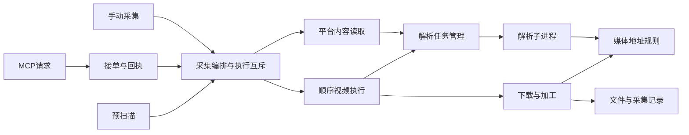

# 2026-11-09 增量功能架构复核

这轮发现并修复了会串参数、串任务和停止不生效的问题。根因集中在新入口复用了旧的共享状态，而缓存、停止流程和依赖边界没有一起接好。服务端没有查到循环引用或缺失的本地模块；运行流程中的耦合确实存在。

修复已在源码完成，229 项自动化检查通过，用户的 B 站 P3 链接也通过当前源码的实际后台解析和取消验证。本轮没有安装或发布。之前交付的 0.5.48 测试包早于这些修复，日常安装仍是 0.5.47。

## 范围与基线

- 分支：`fix/review-0537`；审查基线：`c73bca3`，上一轮产品实现 `414bcfe`。
- 源码：`source/server`、`source/extension`；一并核对构建收集文件规则和现有测试入口。
- 静态依赖检查覆盖全部 46 个服务端 Python 文件；扩展 49 个 JS 文件全部检查语法，并核对 manifest、脚本导入、页面注入和 HTML 脚本引用。
- 深入追踪 MCP/手动采集/预扫描、平台候选选择、解析到下载、停止/退出、父子任务与结果回写。平台提取器由既有行为用例回归；本轮没有逐一进行所有站点的登录 Chrome 保存。
- Ivy v0.5：`C:/Users/Admin/.codex/ivy-dev-system/AGENTS.md`，SHA256 `F6A0F36D4338BDAF24C7D4E33B81140EFEDB6228519D4D8985799759CECAB024`。通用工程规则仍归该入口，项目收尾要求写入 B01。

## 已修问题

| 优先级 | 触发与影响 | 修复 | 主要位置与证据 |
| --- | --- | --- | --- |
| P1 | 预扫描没有占住执行位置，扫描中可以开始另一项采集；还可能使用上一次的音频/GIF过滤参数和停止状态 | 扫描、预览共用检查入口，持有互斥并使用独立参数；后台旧任务收尾前不开始新读取，退出时恢复原任务上下文 | `background.js` 的 `inspectPage`、`ensureBackendIdle`；`test_capture_pipeline.cjs` |
| P1 | 同一链接先提取音频，再选其他画质/字幕，解析缓存仍返回上一组参数的结果 | 缓存键包含网址、格式、画质、字幕语言和字幕开关；读取函数显式传入本次参数 | `matureMedia`、`readPagePayload`、`loadedPageMedia`；缓存行为反例 |
| P1 | 异步解析计入后台忙碌，却没有接入停止/退出；旧同步 API 和 MCP 视频队列也漏了取消解析；X 后备错误处理把停止包装成失败 | 同步/异步解析共用任务所有者，增加停止状态与接口；解析子进程可取消并回收；父任务、公共视频队列和后台退出传递停止；X 保留停止原因 | `media_jobs.py`、`media_resolver.py`、`app.py`、`video_queue.py`、`browser_bridge.py`、`background.js`；实际进程取消及应用退出测试 |
| P1 | MCP 心跳读取共享进度/后台标记时可能把上一任务挂到当前请求，随后停止操作会指向错误编号 | 进度和后台任务分别核对当前子任务编号；预览不借用旧采集进度 | `browser-runner.js` 的 `beat`；接单、执行、结果回传行为用例 |
| P2 | B站解析器、大小预检为调用地址规则而导入整个视频下载器；域名列表重复，分段模块把未知平台当作 X | 地址和重定向规则归到 `media_urls.py`，解析、预检、下载共同调用；未知分段平台明确拒绝 | `bili_resolver.py`、`preflight.py`、`video.py`、`bilibili_media.py`、`segmented_media.py`；依赖与平台地址测试 |
| P2 | MCP 接单器同时拥有视频下载队列，采集层反过来调用接单模块执行媒体任务 | 顺序视频执行移至 `video-sequence.js`，接单器只负责请求、控制与回执 | `browser-runner.js`、`background.js`、`video-sequence.js`；X多视频顺序与手动选择回归 |

这些是明确的职责和状态问题。固定平台域名、协议与端口是既有下载约束；这轮保留这些约束，把分散的后端规则合到一处。此前 B 站的问题是同轨备用地址没有进入选择流程，本轮再次验证了修后的选轨结果。

## 现在的职责与状态归属

| 数据/动作 | 所有者 | 其他模块如何使用 |
| --- | --- | --- |
| 本轮采集参数和执行互斥 | 扩展采集编排 | 手动和 MCP 同一入口；预扫描单独持有本次参数 |
| MCP 请求、租约、控制与回执 | 后台 browser bridge + 扩展 runner | 关联子任务编号，不复制下载执行职责 |
| 批量检查点与修订号 | TaskStore / 后台目录库 | 其他入口调用既有保存路径 |
| 解析进程、忙碌、停止状态 | media jobs；公共队列持有自己的取消信号 | 所有解析调用都能将停止传至解析进程 |
| 平台/协议/端口与重定向规则 | media URLs + 既有公网地址校验 | 解析、预检和下载复用；无任务库或文件写入职责 |
| 文件写入、转换与结果 | 现有下载/存储模块 | 接单层消费结果，不接管保存规则 |

## 验证结果

- 采集 Python **97 项**、顶层 Python **35 项**、采集 JS **97 项**，合计 **229 项通过**。
- 49 个 JS、46 个 Python 语法检查通过；`git diff --check` 通过。
- 依赖检查增加绝对 `server.*` 引用、`from . import` 引用、缺失模块、循环依赖及扩展加载文件检查。新增文件符合现有构建收集规则；本轮没有生成新安装包。
- 旧行为回归包括 X 静态图/GIF/评论/多视频、Pinterest 身份和画板、花瓣精确主图、Instagram 候选、小红书相关采集契约、B站分P与备选轨道、YouTube播放列表/字幕、通用正文、文件保留、任务版本和结果回写。
- 当前源码独立后台经真实 HTTP 解析 `BV1wWJa61EYv/?p=3`：音频返回 `bilibili-audio`，视频返回 `bilibili-dash`，两者均为 P3 / 266.4 秒。取消请求后 **0.219 秒**返回 `stopped`，后台 `busy=false`，测试后台已退出。这轮只重新解析，上一轮完整音频文件保留。
- 真子进程停止与回收测试通过；同步/异步入口的后台退出测试通过。字幕网络读取使用原有有限超时，停止在当前请求结束后检查，不宣称所有网络阶段都即时结束。
- 最初测试用的 FastAPI TestClient 缺少可选 `httpx2`，已改用路由对象验证，并额外完成上述真实 HTTP 测试；没有安装新依赖或删除检查。

本地证据位于 `work/architecture-*`：

| 证据 | 内容 |
| --- | --- |
| `architecture-preview-before.log`、`architecture-python-before.log` | 首轮缺陷反例 |
| `architecture-stop-propagation-before.log` / `after.log` | 扫描旧任务与 X 停止传播 |
| `architecture-heartbeat-before.log`、`architecture-full-js-final.log` | 旧后台标记串任务的反例和最终 JS 回归 |
| `architecture-full-collector.log`、`architecture-full-root.log` | 完整 Python 回归 |
| `architecture-live-smoke/result.json` | 当前源码真实 B 站解析、取消与后台退出 |

## 规格核对与后续

| 条目 | 本轮结果 |
| --- | --- |
| B01 职责和数据边界 | 修复上述状态/依赖缺陷，增加可运行检查；每轮收尾要求已写入项目入口和 README |
| T01 状态/停止/记录 | 解析接入取消与忙碌，进度关联按任务匹配；原有结果/检查点回归通过 |
| A01 MCP和分P | 源码与协议测试通过，B站真实解析通过；新版 Chrome 关弹窗执行仍待现场验收 |
| G01/C01 已有图片、GIF与评论 | 保留提取规则，回归通过；本轮没有重做所有真实网页文件验收 |
| B02/V01 构建与交付 | 未构建、未安装、未发布。旧 0.5.48 包不含本轮修复 |
| U01 UI和工具页 | 本轮未改界面；原布局保留 |

`background.js` 和 `batch.js` 仍承担较多编排，并共享部分运行状态。本轮修掉了已复现的并发、参数和状态串用；后续功能继续变动这些模块时，需要沿调用链检查所有者和取消路径。平台读取规则与任务编排仍应逐步分离，不一次重写全部平台。

后续交付顺序：将本轮源码纳入下一候选包 → 核对包内新模块与启动/退出 → 在新版 Chrome 验收关弹窗接单、暂停/停止/恢复、分P批量。先前 Chrome 加载操作的工具 URL 策略拒绝仍保留原记录，本轮没有改用其他通道重载日常扩展。
